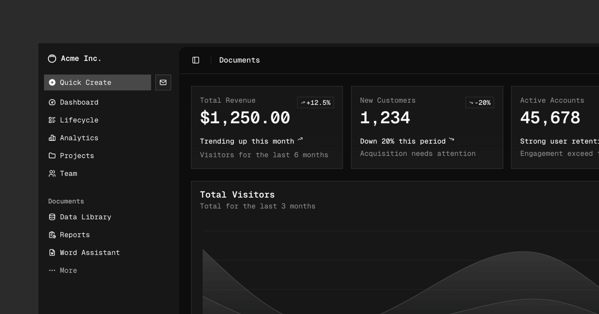

# shadcn/ui

A set of beautifully designed components that you can customize, extend, and build on. Start here then make it your own. Open Source. Open Code. **Use this to build your own component library**.



## Documentation

Visit https://ui.shadcn.com/docs to view the documentation.

## Contributing

Please read the [contributing guide](/CONTRIBUTING.md).

## License

Licensed under the [MIT license](./LICENSE.md).

read -p "Tumcha GitHub Token paste kara: " TOKEN && \
cd ~/ui-repo && \
cat << 'EOF' > README.md
<div align="center">

  

  <h1>🎨 UI Components Kit & Design System</h1>

  <p>
    <strong>A Modern, Accessible & High-Performance React Component Library & Monorepo Starter</strong><br />
    Crafted for rapid full-stack web development, clean design tokens, and zero-runtime styling overhead.
  </p>

  <p>
    
    
    
    
    
  </p>

  <p>
    <a href="#-overview">Overview</a> •
    <a href="#-key-features">Features</a> •
    <a href="#-monorepo-architecture">Architecture</a> •
    <a href="#-quick-start">Quick Start</a> •
    <a href="#-component-usage">Usage</a> •
    <a href="#-roadmap">Roadmap</a>
  </p>

</div>

---

## 🌟 Overview

**UI Components Kit** is a comprehensive, open-source UI primitives collection and **Turborepo + Vite** monorepo starter kit. Designed for modern web applications, SaaS dashboards, and AI utility platforms, it eliminates repetitive boilerplate by providing accessible, themeable, and production-ready React components out of the box.

Whether you are spinning up a new Vite application or scaling an enterprise design system, this kit gives you full ownership of clean, modular TypeScript code.

---

## ✨ Key Features

| Feature | Description |
| :--- | :--- |
| 🧩 **Modular UI Primitives** | Ready-to-use buttons, cards, modals, inputs, navigation bars, and layout wrappers built with strict TypeScript types. |
| 🎨 **Dynamic Theme Provider** | Seamless Light & Dark mode switching powered by CSS variables and Tailwind utility classes. |
| ⚡ **Blazing-Fast Monorepo** | Pre-configured **pnpm workspaces** and **Turborepo** caching for instant builds and hot module replacement (HMR). |
| ♿ **Accessibility First (a11y)** | Keyboard navigation, focus management, and ARIA attributes baked directly into interactive primitives. |
| 📦 **Zero Lock-in Templates** | Includes ready-to-clone `vite-monorepo` templates so you can bootstrap new apps in seconds. |

---

## 🏗️ Monorepo Architecture

```text
ui-components-kit/
├── packages/
│   ├── ui/                     # Core reusable React components, hooks & global styles
│   │   ├── src/components/     # Primitive UI building blocks
│   │   ├── src/hooks/          # Custom React utility hooks
│   │   └── src/styles/         # Global CSS tokens & Tailwind base rules
│   ├── eslint-config/          # Shared linting rules across workspaces
│   └── typescript-config/      # Strict shared tsconfig presets
├── templates/
│   └── vite-monorepo/          # Ready-to-use Vite + React starter template
├── turbo.json                  # Turborepo build pipeline configuration
├── vitest.workspace.ts         # Unit & component testing workspace setup
└── README.md                   # Documentation

